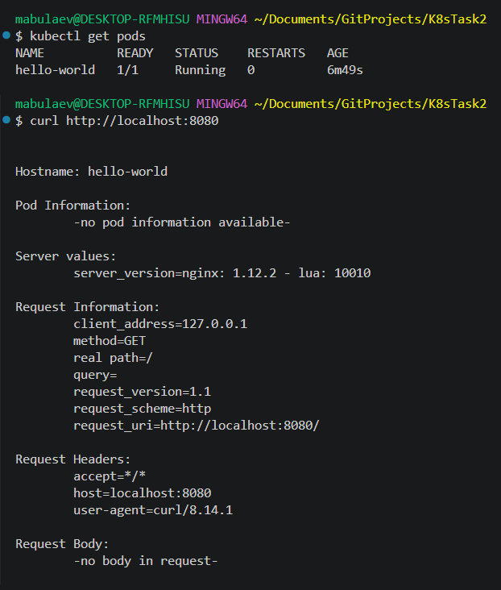
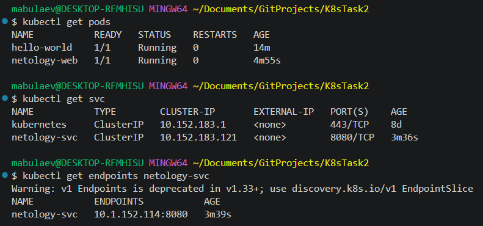
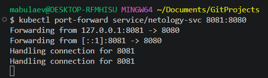
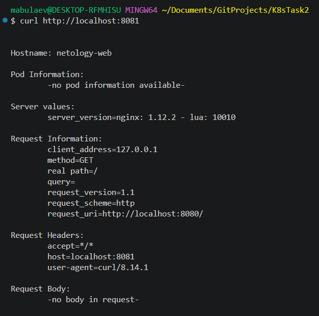

# Домашнее задание к занятию "`Базовые объекты K8S`" - `Булаев Максим`

### Задание 1. Создать Pod с именем hello-world

1) Создать манифест (yaml-конфигурацию) Pod.
2) Использовать image - gcr.io/kubernetes-e2e-test-images/echoserver:2.2.
3) Подключиться локально к Pod с помощью kubectl port-forward и вывести значение (curl или в браузере).

---

### Задание 2. Создать Service и подключить его к Pod

1) Создать Pod с именем netology-web.
2) Использовать image — gcr.io/kubernetes-e2e-test-images/echoserver:2.2.
3) Создать Service с именем netology-svc и подключить к netology-web.
4) Подключиться локально к Service с помощью kubectl port-forward и вывести значение (curl или в браузере).

